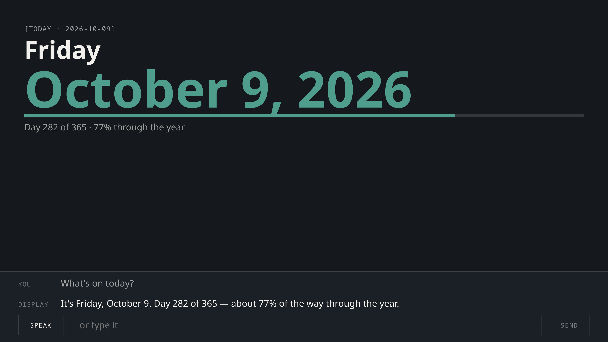

# voice-display-mcp-host

A smart-display style web host for MCP servers: voice in, spoken answers out,
MCP Apps cards rendered via AppBridge.

Point it at any MCP server over Streamable HTTP and you get a demo-ready
voice display: somebody speaks, a tool answers, the tool's own words are read
aloud, and the card that tool declares is drawn on a 16:9 stage. It is the
scaffolding you would otherwise write twice — once badly — before you could
show your server to anyone.

Useful for building and demoing Alexa+ MCP integrations, and for any other
place a spoken answer wants a screen behind it.



## Quick start

No cloud account, no keys, no model.

```bash
make dev
```

Three things come up: the example MCP server on `:8081`, the host agent on
`:8080`, and the client on `:5180`. Open the client, type or say *"what's on
today?"*, and the example server's `get_today` tool answers with a card.

```bash
make test     # python tests + typescript strict
make lint     # ruff
make build    # production client bundle
make e2e      # the whole thing, driven in headless Chromium
```

## Pointing it at your own server

```bash
MCP_URL=https://your-server.example.com/mcp make host
```

Then teach the router about the handful of things people will say most, in
`host/voice_display_host/__main__.py`:

```python
FastLane(
    tool="get_inbox",
    matches=(r"\bmail\b", r"\binbox\b", r"anything new\b"),
    declines=(r"\bsent\b", r"\barchive\b"),
)
```

Everything else can go to a model. Set `ROUTER_MODEL` to a Bedrock model id
and the router will fall back to tool-use routing; leave it unset and the
host uses rules plus a named fallback tool, which costs nothing and is often
enough.

| Variable | Default | What it does |
| --- | --- | --- |
| `MCP_URL` | `http://127.0.0.1:8081/mcp` | The server to put a face on |
| `ROUTER_MODEL` | *(unset)* | Bedrock model id for tool-use routing |
| `TTS_VOICE` | *(unset)* | Polly voice; unset means the browser speaks |
| `TTS_ENGINE` | `neural` | Polly engine |
| `FALLBACK_TOOL` | `get_today` | Tool for anything no lane claims |
| `TURNS_PER_MINUTE_PER_VISITOR` | `20` | Per-visitor rate limit |
| `TURNS_PER_MINUTE_PER_IP` | `60` | Per-address ceiling behind it |

## How MCP Apps cards are hosted

A card is one self-contained HTML document the MCP server publishes as a
`ui://` resource and binds to a tool. The display fetches it, writes it into
a sandboxed iframe, and talks to it over `postMessage`.

**The handshake retries.** The card cannot know when the host attached its
side of the channel. A host that creates the iframe and wires its transport
on the `load` event is not listening yet when the document first runs, so a
single fire-and-forget `ui/initialize` is lost and the card hangs looking
initialised to nobody. The bridge repeats it every 250ms until the host
answers — *with the same id every time*. A fresh id per retry means the
host's reply answers whichever id it saw and no longer matches the one the
card is waiting on, so the handshake never completes.

**The sandbox is `allow-scripts` and not `allow-same-origin`.** The card gets
an opaque origin and cannot reach the page that hosts it. That is the
isolation the security model exists for, and it is also why a card cannot
fetch anything: a relative URL resolves to the sandbox, and so does a
`'self'` CSP.

**Fonts and images need `resourceDomains`.** The Apps default CSP has no
`font-src` at all, so a web font is unreachable until the server widens the
card's CSP to the absolute origin serving it:

```python
CARD_CSP = ResourceCsp(resource_domains=["https://your-host.example.com"])
```

**The data is pushed, not negotiated for.** A tool result is idempotent — the
card just renders again — so the host sends it on connect, again when the
card says it initialised, and once more shortly after. Gating the first send
on the handshake is a deadlock waiting to happen.

**Mount on the HTML, push on the facts.** Rebuilding `srcdoc` when the data
changes throws the card's document away and builds it again: it goes blank,
then redraws. Keep the mount keyed on the card's HTML and push new facts into
the live document.

## Lessons learned

Each of these cost real time somewhere else first.

- **The handshake has to retry, with a stable id.** As above. This is the
  single biggest source of "the card is blank and nothing is wrong".
- **`sendToolResult` takes the whole result, not the structure.** It wants
  `{content, structuredContent}`; sending the structure alone gets you a card
  that initialises and never renders.
- **Fast lanes before model routing.** A model offered two defensible tools
  picks the broader one. If one tool's output contains another's, routing
  drifts to the container and every assertion downstream still passes —
  because the answer is not wrong, just much more than was asked. Measured at
  40 out of 40 on one such pair. Make the narrow case a rule.
- **A rule that is not certain should decline.** Answering the wrong question
  quickly is worse than answering the right one slowly.
- **Never let a model rewrite a tool's text.** It will round 28.6% to "about a
  third" and disagree with the card beside it, and every content assertion
  will still pass.
- **Polly: cache the client, and prefer neural over generative.** A boto3
  client per request spends longer resolving credentials than synthesizing
  (1.7s → 0.6s when cached). Generative voices sound better and arrive later;
  on a display where the card is already up, the wait is what people notice.
- **Blocking SDK calls in an async handler serialize everyone.** boto3 is
  synchronous. Left on the event loop, five people asking at once took 3-4x
  as long as one. `anyio.to_thread.run_sync` fixed it; the symptom before
  that was "it gets slower when more people use it", with nothing in the logs.
- **Decorator order can unpublish a tool.** `@apps.tool` applied to a function
  defined *after* `MCPServer(...)` registers nothing: the extension's tools
  are snapshotted at construction. The resource serves, the tool vanishes from
  the list, and there is no error. Count your tools in a test.
- **Wait on a render signal, not an app name.** A card declares its name when
  its script runs, which is before any data reaches it. A test that waits for
  the name passes for a card that mounted and drew nothing — and screenshots
  an empty rectangle. The bridge exposes `CARD_RENDERED` for this.
- **A failed turn has to be written like a normal turn.** Updating only the
  visible caption left the `aria-live` region announcing the *previous*
  answer as though it were current, so a screen reader was told something
  false and anything watching that element waited forever.

## Layout

```
client/         React + TypeScript display: 16:9 stage, captions, card host
host/           Python host agent: routing, passthrough, rate limits, TTS
example-server/ A tiny MCP server with two tools and two cards
scripts/e2e/    Headless Chromium run of the whole thing
```

## Licence

MIT. See [LICENSE](LICENSE).

Built during the Build, Ship, Shape hackathon.
